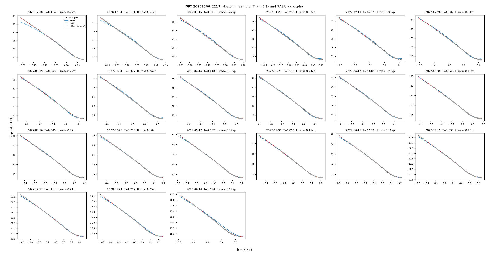
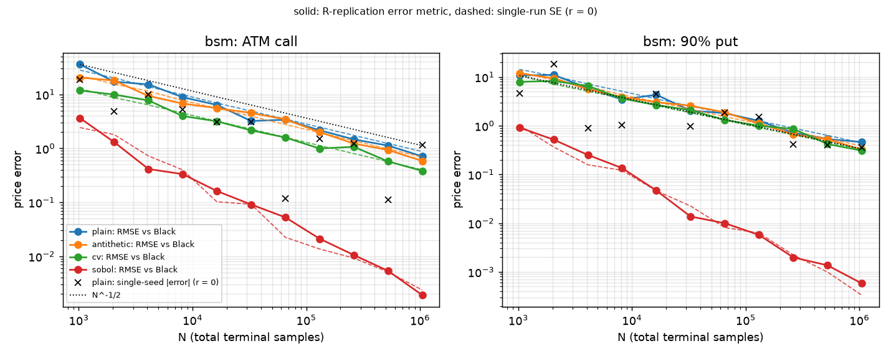

# qpricer

**A compact, independently validated multi-model option pricer — Black-76, Heston and SABR — for vanilla and
exotic options, calibrated to a real SPX implied-volatility surface.**

## What it is

qpricer is a small Python library (NumPy/SciPy, about 2.6k lines of core code) that prices European, barrier,
Asian and mono-asset autocallable options under three models and checks every number against an independent
method:

- **Black-76 / BSM** in forward form: prices, Greeks and an implied-vol solver (Newton on vega, Brent fallback).
- **Heston**: the "little trap" characteristic function, priced by **COS** with a self-checked truncation
  ((N, L) refined from (256, 18) to (2N, L + 6) until successive prices agree within 1e-9·F), cross-checked by
  the **Lewis** single integral, and simulated by **Andersen QE / QE-M** (Euler full truncation for comparison).
- **SABR with β = 1**: Hagan's lognormal implied vol, checked against Monte Carlo (log-Euler and conditional
  "mixing" estimators).
- **Exotics**: barriers (Reiner–Rubinstein closed form, Brownian-bridge MC, Broadie–Glasserman–Kou shift),
  arithmetic Asians (Kemna–Vorst geometric control variate) and a mono-asset autocallable with a
  BSM-vs-Heston model-risk attribution.
- **Market data and calibration**: an SPX option-chain snapshot (yfinance), cleaned, with forwards and discount
  factors implied from put-call parity; Heston fitted to the whole surface and SABR per expiry by least squares,
  with multi-start, standard errors and no-arbitrage diagnostics.
- **Benchmark**: Monte Carlo vs closed form / COS — plain, antithetic, control variate and scrambled Sobol' RQMC
  — with convergence slopes, variance-reduction factors and timing.

Pricing kernels are forward-based (`F`, `DF`, `T`; never raw `r`/`q`), vectorised, and all randomness goes
through an explicit `np.random.Generator(seed)`. Every Monte Carlo price comes with its standard error.

## Highlights

Every number below is measured, printed by a script in this repository, and recorded in
`docs/validation/gate_outputs/` (snapshot: SPX, 2026-11-06 22:13 UTC).

| Check | Measured | Tolerance | Reproduced by |
|---|---|---|---|
| Black-76 put-call parity, K/F ∈ [0.25, 4] | 1.1e-13 | 1e-12 | `scripts/phase1_gates.py` |
| Implied-vol round trip, σ ∈ [0.05, 1], T ∈ [0.02, 5] | ≤ 8.2e-13 | 1e-10 | `scripts/phase1_gates.py` |
| Heston COS vs Lewis, K ∈ [60, 150], T ∈ [0.1, 3], 4 parameter sets | ≤ 1.8e-10 | 1e-6 | `scripts/phase2_gates.py` |
| COS robustness, 300 random SPX-like sets × 6 maturities | 0/1800 above 1e-6 (fixed N = 256, L = 18: 22.9 %) | 1e-6 | `scripts/phase2_gates.py` |
| Heston QE / QE-M Monte Carlo vs COS (2e5 paths) | 24/24 within 3 SE, max \|z\| 0.71 | 3 SE | `scripts/phase2_gates.py` |
| SABR Hagan vs Monte Carlo, T ≤ 1, \|ln K/F\| ≤ 0.2, ν²T ≤ 0.16 | max \|z\| 1.68 over 21 comparisons | 3 SE | `scripts/phase3_gates.py` |
| Barrier: in + out = vanilla on the same paths; Brownian-bridge MC vs Reiner–Rubinstein | 3.6e-15; max \|z\| 1.99 | 1e-12; 3 SE | `scripts/phase4_gates.py` |
| Arithmetic Asian, geometric control variate: variance-reduction factor | 612 – 2202 | reported | `scripts/phase4_gates.py` |
| SPX parity regression: expiries kept, min R² | 39/40, 0.999941 | R² > 0.999 | `scripts/build_market.py` |
| Heston surface fit to SPX (565 quotes, 21 expiries with T ≥ 0.1) | 16/16 starts in one basin; IV RMSE 0.328 vol pt in sample, 1.379 out of sample (18 short expiries) | completes, no NaN | `scripts/run_calibration.py`, `scripts/phase5_gates.py` |
| Autocallable (quarterly, 1.5 y): calibrated Heston minus BSM at ATM vol | −0.0187 per unit notional (CRN SE 0.0002) | reported | `scripts/autocall_compare.py`, `scripts/phase4_gates.py` |
| Plain-MC error slope vs N (N = 2¹⁰ … 2²⁰), 12 fits under BSM and Heston | −0.554 … −0.487 | [−0.6, −0.4] | `scripts/run_benchmarks.py`, `scripts/phase6_gates.py` |

The pooled RMSEs are the quote-weighted averages of the per-expiry table
`report/calibration_expiry_20261106_2213.csv`. Calibrated Heston parameters:
v0 = 0.0524, κ = 4.58, θ = 0.0529, ξ = 1.65, ρ = −0.752 (Feller ratio 0.178), in
`data/processed/heston_fit_20261106_2213.json`.

<p align="center">
  
  <br><em>SPX smiles, 2026-11-06: market quotes with bid-ask bands, the Heston surface fit and per-expiry SABR fits
  (expiries with T ≥ 0.1 y; per-expiry Heston RMSE in each title).</em>
</p>

<p align="center">
  
  <br><em>Monte Carlo error vs N under BSM (SPX-like forward, ~1 y): plain, antithetic and control-variate errors
  decay like N^-1/2; scrambled Sobol' RQMC decays close to N^-1.</em>
</p>

## Installation

Python ≥ 3.10.

```bash
git clone <repository-url> qpricer && cd qpricer
python -m venv .venv && source .venv/bin/activate
pip install -e ".[dev]"
```

Dependencies: numpy, scipy, pandas, matplotlib, pyarrow (parquet I/O) and yfinance (data download only);
pytest and ruff for development.

## Quick start

```python
import numpy as np

from qpricer.engines.fourier import cos_price, lewis_price
from qpricer.engines.mc import european_price
from qpricer.iv import implied_vol
from qpricer.models import bsm
from qpricer.models.heston import HestonParams

F, DF, T = 100.0, 0.95, 1.0                      # forward, discount factor, maturity (years)
K = np.array([80.0, 100.0, 120.0])

# Black-76 price and implied-vol round trip
c = bsm.price(F, K, T, DF, 0.2, cp=1)
print("Black-76 calls:", c)
print("implied vol   :", implied_vol(c, F, K, T, DF, cp=1))

# Heston: COS (self-checking truncation) vs Lewis vs QE-M Monte Carlo, puts
p = HestonParams(kappa=1.5768, theta=0.0398, xi=0.5751, rho=-0.5711, v0=0.0175)
cos = cos_price(F, K, T, DF, p, cp=-1)
print("Heston COS    :", cos)
print("|COS - Lewis| :", np.abs(cos - lewis_price(F, K, T, DF, p, cp=-1)).max())
mc, se, n, seed = european_price(F, K, T, DF, p, cp=-1, n_steps=32, n_paths=200_000, seed=1)
print("QE-M MC       :", mc, " z =", (mc - cos) / se)
print("Heston smile  :", implied_vol(cos, F, K, T, DF, cp=-1))
```

Output:

```text
Black-76 calls: [20.12663304  7.56728908  2.03993387]
implied vol   : [0.2 0.2 0.2]
Heston COS    : [ 1.17480682  5.49589766 19.45868673]
|COS - Lewis| : 1.8108181620846153e-10
QE-M MC       : [ 1.17740151  5.52561127 19.47684123]  z = [0.24002244 1.31521667 0.57923541]
Heston smile  : [0.20264008 0.14513963 0.12777102]
```

## Reproducing the results

All scripts are run from the repository root, e.g. `python scripts/phase2_gates.py`; each one documents its
inputs, outputs and options in its module docstring.

| Step | Script | Writes |
|---|---|---|
| 0. Market data | `fetch_spx.py` (live yfinance download), then `build_market.py` | `data/raw/spx_<stamp>.parquet`; `data/processed/{market,cleaning,surface,arb_removed}_<stamp>.csv` |
| 1. Black-76 | `phase1_gates.py` | gate table |
| 2. Heston | `phase2_gates.py`, `heston_euler_bias.py` | gate table; `report/figures/heston_euler_bias.*` |
| 3. SABR | `sabr_degradation.py`, then `phase3_gates.py` | `report/figures/sabr_hagan_vs_mc*`; gate table |
| 4. Exotics | `exotics_figures.py`, `autocall_compare.py --heston-params data/processed/heston_fit_20261106_2213.json`, `phase4_gates.py` | `report/figures/{barrier,asian,autocall}_*`; gate table |
| 5. Calibration | `run_calibration.py`, then `phase5_gates.py` | `data/processed/heston_fit_<stamp>.json`; `report/calibration_*`; gate table |
| 6. Benchmark | `run_benchmarks.py`, then `phase6_gates.py` | `report/figures/benchmark_*` + sha256 manifest; gate table |

The gate tables of the committed run are in `docs/validation/gate_outputs/phase{1..6}_gates.txt`.
The autocallable gate of step 4 uses the calibrated parameters of step 5.

**Market data.** `data/raw/` is gitignored: the raw yfinance snapshot `spx_20261106_2213.parquet` is not
redistributed. The processed snapshot derived from it is shipped in `data/processed/` (per-expiry parity table
with F, DF, R², the cleaning and surface statistics, and the calibrated Heston parameters), together with every
calibration table and figure in `report/`. With the shipped files, the model, exotic and benchmark scripts run
as they are. Rebuilding the surface needs a raw snapshot: `build_market.py`, `run_calibration.py`,
`tests/test_calibration.py`, the real-snapshot test in `tests/test_market.py` and the phase 0 and phase 5 tests
in `tests/validation/` fail — by design they never skip — until one is present. `fetch_spx.py` downloads a new,
live snapshot, so its numbers will differ from those reported here; several scripts are pinned to the
`20261106_2213` stamp and must be pointed at the new one.

**Tests.**

```bash
pytest -m "not slow" -q   # fast subset: 502 tests
pytest -q                 # full suite: 599 tests, about 20 minutes
ruff check src tests scripts
```

## Repository layout

```
src/qpricer/
  market.py          per-expiry MarketData (F, DF, T); forwards and DFs implied from put-call parity
  data.py            SPX chain loading and cleaning, OTM surface, static-arbitrage filter
  iv.py              Black-76 implied-vol inversion
  products.py        payoff and term-sheet definitions (vanilla, barrier, Asian, autocallable)
  calibration.py     targets, least-squares losses, multi-start, diagnostics, arbitrage checks
  models/            bsm.py (Black-76 price, Greeks), heston.py (characteristic function), sabr.py (Hagan)
  engines/           analytic.py (Reiner-Rubinstein, BGK, Kemna-Vorst, autocallable oracles),
                     fourier.py (COS, Lewis), mc.py (Heston and SABR path schemes),
                     exotic_mc.py (barrier, Asian, autocallable MC), vr.py (antithetic, control variates, RQMC)
scripts/             data download, gate scripts per phase, calibration, benchmark, figures
tests/               unit tests per module
  validation/        independent re-implementations of every phase's gates
  golden/            frozen oracle values from independent sources (source stated in each file)
data/processed/      shipped SPX snapshot tables and calibrated parameters
report/              calibration tables; figures/ with the CSV behind every figure
docs/
  ROADMAP.md         phases, scope and acceptance gates
  derivations/       one maths note per topic (setup, result, derivation, pitfalls, oracles, references)
  validation/        independent validation report per phase; gate_outputs/ with the measured gate tables
  DECISIONS.md       every non-obvious modelling choice, numbered D-001 …
  OPEN_ISSUES.md     known limitations and unresolved findings
paper/               the write-up (English: paper/en/, paper/qpricer_en.pdf)
```

Docstrings cite the equation and section numbers of the matching note in `docs/derivations/`.

## Validation philosophy

- **Two independent methods** for every number: closed form vs Fourier vs Monte Carlo (Black-76 vs COS vs
  Lewis vs QE-M; Reiner–Rubinstein vs Brownian-bridge MC; Kemna–Vorst vs MC; Hagan vs SABR MC).
- **Limiting cases** must reproduce a simpler model: Heston with ξ → 0 is Black at the average variance,
  SABR with ν → 0 is a flat smile at α.
- **No-arbitrage identities**: put-call parity, in + out = vanilla on the same paths, monotonicity and
  convexity in K, calendar and butterfly checks on the market surface.
- **Monte Carlo in standard-error units**: a comparison passes within 3 SE, the error must decay like N^-1/2,
  and false-fail rates of the 3 SE gates are measured on fresh seeds.
- **Golden files from independent references**: `tests/golden/` holds published table values or the agreement of
  two independent methods, with the source stated in each file; existing golden values are never edited.
- **Tolerances are fixed before looking** and never loosened; no test is skipped or special-cased. A gate that
  fails after three fix attempts is logged in `docs/OPEN_ISSUES.md` rather than tuned away.
- **Independent re-implementation per phase**: `tests/validation/test_phase<N>_independent.py` recomputes each
  phase's gates with its own code, without reusing the implementation's helpers; the findings are written up in
  `docs/validation/phase<N>.md`.
- **No fabricated data**: every reported number comes from a re-runnable script; synthetic data is always
  labelled `synthetic`.

## Known limitations

Open items from `docs/OPEN_ISSUES.md`:

- **Deep-ITM implied vols** (beyond |z| ≈ 3, outside the gate domain) can lose accuracy up to ~2e-4 without a
  flag; calibration inverts OTM quotes only, where the error is ≤ 1e-14.
- **AMST (2007) published Heston prices** are not reproduced at their stated precision (most likely rounded
  parameters in the paper); they are not used as oracles.
- **COS truncation**: the fixed L = 12 range first proposed in the Heston note fails the 1e-6 gate on two
  parameter sets; the code uses the self-checking (N, L) (erratum D-017), but the note's oracle section still
  quotes L = 12.
- **SABR fits are Hagan parametrisations**: all 39 per-expiry SABR fits to SPX lie outside the validated Hagan
  domain (ν²T > 0.16), so they describe smiles, not SABR dynamics.
- **Deng–Mallett–McCann (2011) autocallable Case 2** is not reproduced: two independent implementations give
  97.51 against the published 98.39; the cause (contract convention or FD error in the paper) is unresolved.
- **Autocallable reference level** still uses the first expiry's parity DF, 0.074 % away from the smoothed
  short-end curve.
- **Minor nits**: a coupon-leg helper assumes scalar coupons, two gate-script citations are fixed numbers, and
  the control-variate path raises when a strike has an all-zero control payoff.
- **Size**: the core `src/` is 2644 lines, above the original ≲ 1500-line target; validated modules were not
  refactored to meet it.

## Paper

A study-oriented write-up of the whole project — models, numerical methods, data, validation, calibration and
benchmark results — is in [`paper/`](paper/): [`paper/qpricer_en.pdf`](paper/qpricer_en.pdf), with LaTeX
sources in `paper/en/`. An Italian version also exists.

## How it was built

The code was generated with Claude Code under the author's specification and mathematical supervision, using a
researcher → implementer → independent-validator workflow; every result rests on automated tests and independent
re-implementations.

## Author

Emanuele Renzoni

## License

To be added.
